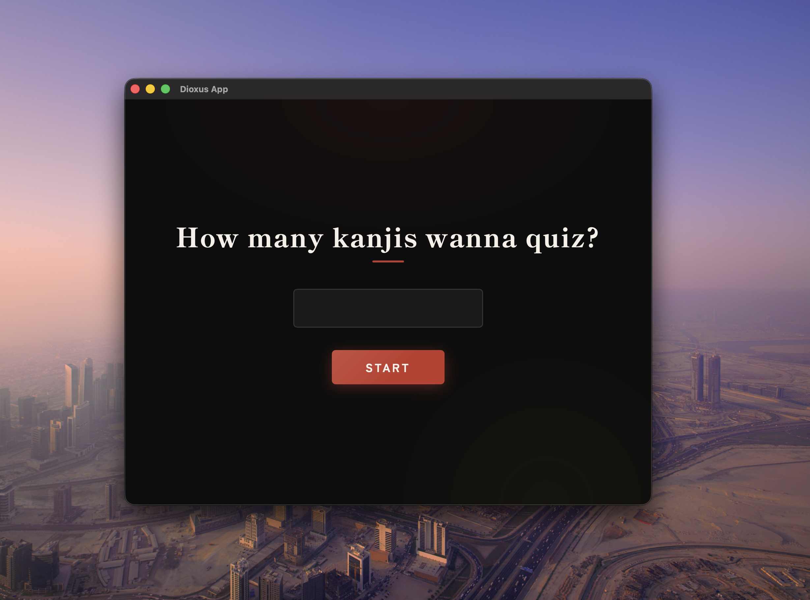
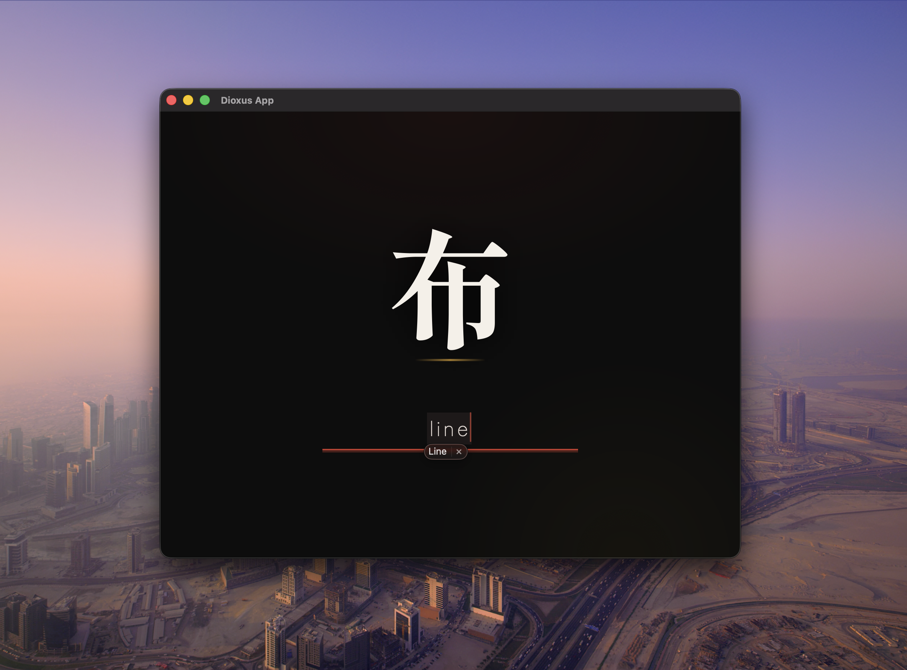

# 漢字 Quiz

A minimal, fast kanji flashcard app built with [Dioxus](https://dioxuslabs.com/) and Rust. Load your own CSV deck, pick how many kanji to drill, and type the keyword from memory — no clicking, no fuss.

---

## Screenshots

### Landing



### Quiz



---

## Features

- Reads any CSV deck with `kanji` and `keyword` columns
- Shuffles and slices to exactly the number you choose
- Auto-advances on correct input — no submit button
- Case-insensitive matching, whitespace-trimmed

---

## Getting Started

### Prerequisites

- [Rust](https://rustup.rs/) (stable)
- [Dioxus CLI](https://dioxuslabs.com/learn/0.6/getting_started/)

```bash
cargo install dioxus-cli
```

### Run

```bash
dx serve
```

Then open [http://localhost:8080](http://localhost:8080).

---

## CSV Format

Place your deck at `data.csv` in the project root. Expected columns:

```csv
kanji,keyword
日,sun
山,mountain
火,fire
```

Any extra columns are ignored.

---

## Project Structure

```
├── src/
│   ├── main.rs        # App, Landing, Hero components
│   └── kanji.rs       # CSV parsing and Kanji struct
├── assets/
│   ├── main.css       # Styles
│   └── favicon.ico
└── data.csv           # Your kanji deck
```

---

## Built With

- [Dioxus](https://dioxuslabs.com/) — Rust UI framework
- [rand](https://docs.rs/rand) — Deck shuffling
- [Shippori Mincho](https://fonts.google.com/specimen/Shippori+Mincho) / [Zen Kaku Gothic New](https://fonts.google.com/specimen/Zen+Kaku+Gothic+New) — Typography
